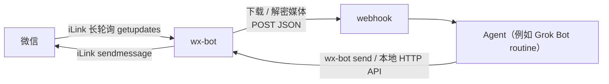

<p align="center">
  <picture>
    <source media="(prefers-color-scheme: dark)" srcset="docs/assets/logo-dark.svg">
    
  </picture>
</p>

<h1 align="center">wx-bot</h1>

<p align="center">
  <strong>把个人微信接到你自己的 Agent webhook。</strong>
</p>

<p align="center">
  
  
  
  
  
</p>

<p align="center">
  微信消息经腾讯官方 <a href="https://ilinkai.weixin.qq.com">ClawBot / iLink</a> 长轮询进入本机
  <code>wx-bot</code>，下载并解密媒体后 <code>POST</code> JSON 到绑定的 webhook
  （例如 Grok Bot routine）。Agent 再通过 <code>wx-bot send</code> 或本机 HTTP API 把消息发回微信。
</p>

<p align="center">
  <a href="#为什么是-wx-bot">为什么是 wx-bot</a>
  · <a href="#功能">功能</a>
  · <a href="#架构">架构</a>
  · <a href="#快速开始">快速开始</a>
  · <a href="#配置">配置</a>
  · <a href="#命令行">命令行</a>
  · <a href="#安全">安全</a>
  · <a href="#faq">FAQ</a>
</p>

---

## 为什么是 wx-bot

- **只出站。** 本地发送 API 仅绑定 loopback（`127.0.0.1` / `::1` / `localhost`）。
- **官方接口。** 走腾讯 ClawBot / iLink 的 `getupdates` 长轮询与 `sendmessage`。
- **一对一绑定。** 一个 binding = 一个微信账号 = 一个 ClawBot = 一个 webhook；会话过期只停该 binding。
- **默认可控。** 白名单默认是扫码登录的 `ilink_user_id`；状态目录 `0700`，会话 / token 文件 `0600`，原子写入。
- **任意 Agent。** 出站 JSON webhook 即可对接；回微信走本机 CLI 或 loopback HTTP。

> [!NOTE]
> 回微信的内容是**纯文本**。不要发 Markdown；Markdown 应由 Agent 侧去掉。`wx-bot` 按原文发送。

## 功能

| 能力 | 说明 |
| --- | --- |
| **文本** | 入站多段文本以换行拼接；回发按 rune 切分，每片最多 2000。 |
| **图片** | 下载并 AES-128-ECB 解密后落盘；`--image` / `image` 回发。 |
| **语音** | 优先把 `voice_item.text` 写入 `voice_text`；无转写时再下载语音文件。 |
| **文件** | 下载解密后落盘；`--file` / `file` 回发。 |
| **视频** | 下载解密后落盘；`--video` / `video` 回发。 |
| **多绑定** | 一个微信账号对应一个 webhook；`wx-bot run` 为每个已登录且未过期的 binding 起独立 poller。 |
| **白名单** | `allow_wxids` 为空时，默认只放行登录时扫码的 `ilink_user_id`。 |
| **本地发送 API** | 仅 `run` 期间监听 loopback：`POST /v1/send`、`GET /v1/status`、`GET /healthz`。 |
| **会话过期** | iLink `errcode` / `ret` `-14` 时停止该 binding 的 poller，写入 `expired` 标记，其它 binding 不受影响。 |
| **0600 状态** | 状态 / 媒体目录 `0700`，会话、token、cursor、媒体文件 `0600`，原子写入（临时文件 + rename）。 |

其它 `item` 类型会忽略。未授权发送者默认只打 INFO 日志、不转发、不回复；`forward_unallowed: true` 时会转发，但仍不回复。

## 架构



平台：**仅 Linux 与 macOS**（amd64 / arm64）。不支持 Windows（`GOOS=windows go build` 会因平台守卫编译失败）。

## 快速开始

需要 Go 1.24+。没有 Go 时，可用 `make cross` 预先放在 `dist/` 里的二进制。

### 1. 安装

```bash
git clone https://github.com/lawrencewzen/wx-bot
cd wx-bot
./install.sh                 # 安装到 ~/.local/bin
```

`install.sh` 会在缺失时写入 `~/.config/wx-bot/config.json` 与 `~/.config/wx-bot/env`（均为 `0600`），配置目录为 `0700`。需要的话把 `~/.local/bin` 加入 `PATH`。

```bash
./install.sh --system        # 安装到 /usr/local/bin
./install.sh --prefix DIR    # 安装到 DIR/bin
./install.sh --service       # 同时安装 systemd --user 或 launchd
```

或：

```bash
make build
make install                 # ~/.local/bin/wx-bot
make cross                   # dist/wx-bot_{linux,darwin}_{amd64,arm64}
```

### 2. 配置

默认路径 `~/.config/wx-bot/config.json`（可用 `-config` 覆盖）。把 `webhook.url` 改成你的 Agent 地址，并填写 `~/.config/wx-bot/env`。

```json
{
  "state_dir": "~/.local/state/wx-bot",
  "media_dir": "~/.local/state/wx-bot/media",
  "local_api": {
    "listen": "127.0.0.1:18790",
    "token": ""
  },
  "bindings": [
    {
      "name": "xiaox",
      "webhook": {
        "url": "https://example.com/webhook/wx-bot",
        "key": "env:WXBOT_WEBHOOK_KEY",
        "key_header": "Authorization",
        "key_prefix": "Bearer ",
        "secret": "env:WXBOT_WEBHOOK_SECRET"
      },
      "allow_wxids": [],
      "forward_unallowed": false
    }
  ]
}
```

完整字段见 [配置](#配置)。示例文件：[`examples/config.example.json`](examples/config.example.json)、[`examples/env.example`](examples/env.example)。

### 3. 扫码登录

```bash
wx-bot login xiaox
```

终端打印二维码和 URL。用微信扫描；二维码过期时会自动刷新（最多 3 次）。成功后打印 `binding`、`ilink_user_id` 和当前 allowlist。

### 4. 运行

```bash
wx-bot run
```

为所有已登录且未过期的 binding 启动 poller，并在 `local_api.listen` 上打开本地 API。`SIGINT` / `SIGTERM` 后退出。

```bash
wx-bot status
wx-bot send --binding xiaox --to <wxid> --text '你好'
```

<details>
<summary>Linux：systemd --user</summary>

```bash
./install.sh --service
systemctl --user enable --now wx-bot
journalctl --user -u wx-bot -f
```

单元文件：[`deploy/systemd/wx-bot.service`](deploy/systemd/wx-bot.service)。`EnvironmentFile=-%h/.config/wx-bot/env`。`install.sh` 会按实际安装路径改写 `ExecStart`。

</details>

<details>
<summary>macOS：launchd</summary>

```bash
./install.sh --service
launchctl load ~/Library/LaunchAgents/com.lawrencewzen.wx-bot.plist
```

plist：[`deploy/launchd/com.lawrencewzen.wx-bot.plist`](deploy/launchd/com.lawrencewzen.wx-bot.plist)。`install.sh --service` 把二进制路径换成安装位置，把日志写到 `$HOME/Library/Logs/wx-bot.log` 与 `wx-bot.err`（launchd 不展开 `~`），并用 `/bin/sh -c` 在启动前 `set -a; . "$HOME/.config/wx-bot/env"`，再 `exec wx-bot run`。`--system` 时 plist 装到 `/Library/LaunchAgents/`。

</details>

<details>
<summary>没有 systemd：tmux / nohup</summary>

```bash
tmux new -s wx-bot 'wx-bot run'

# 或
nohup wx-bot run >>~/.local/state/wx-bot/wx-bot.log 2>&1 &

crontab -e
# @reboot /home/you/.local/bin/wx-bot run >>/home/you/.local/state/wx-bot/wx-bot.log 2>&1
```

服务进程通过 `~/.config/wx-bot/env`（`KEY=value`，`0600`）注入变量。无 systemd 时请自行在启动环境里 source 该文件。

</details>

## 配置

默认路径 `~/.config/wx-bot/config.json`。未知 JSON 字段会被拒绝。任意字符串字段可用 `env:VAR_NAME` 从环境变量读取；变量未设置或为空时加载失败（错误含字段名和变量名，不含变量值）。`~` / `~/...` 会展开为家目录。

| 字段 | 默认 | 说明 |
| --- | --- | --- |
| `state_dir` | `~/.local/state/wx-bot` | 每 binding 的会话目录根：`state_dir/<name>/`。 |
| `media_dir` | `state_dir/media` | 入站媒体落盘根：`media_dir/<binding>/<yyyymmdd>/<msgid>_<sanitized>`。 |
| `local_api.listen` | `127.0.0.1:18790` | 必须是 loopback（`127.0.0.1` / `::1` / `localhost`），否则拒绝启动。 |
| `local_api.token` | `""` | 非空时，`/v1/*` 需要 `Authorization: Bearer <token>`。`/healthz` 不校验。 |
| `bindings[].name` | （必填） | `[a-z0-9_-]{1,32}`，全局唯一。 |
| `bindings[].webhook.url` | `""` | Agent webhook。空则入站消息被丢弃。 |
| `bindings[].webhook.key` | `""` | 非空时作为请求头发给 webhook。 |
| `bindings[].webhook.key_header` | `Authorization` | key 所在的 HTTP 头名。 |
| `bindings[].webhook.key_prefix` | `Bearer ` | 头值前缀，与 `key` 拼接。 |
| `bindings[].webhook.secret` | `""` | 非空时附加 HMAC：`X-WxBot-Signature: sha256=<HMAC-SHA256(body)>` 与 `X-WxBot-Timestamp`（Unix 秒）。 |
| `bindings[].allow_wxids` | `[]` | 空则默认只放行登录时保存的 `ilink_user_id`。 |
| `bindings[].forward_unallowed` | `false` | `true` 时把非白名单消息也 POST 到 webhook，但仍不保存其 `context_token`、不回复。 |

服务进程通过 `~/.config/wx-bot/env`（`KEY=value`，不要 `export`）注入变量：systemd 用 `EnvironmentFile=-%h/.config/wx-bot/env`，launchd 由 wrapper `set -a` 后再 `exec wx-bot run`。

## Webhook

`POST`，`Content-Type: application/json`，超时 15s；5xx 与网络错误最多 3 次退避重试。

若配置了 `webhook.key`，默认发送 `Authorization: Bearer <key>`（可用 `key_header` / `key_prefix` 调整）。若配置了 `webhook.secret`，`X-WxBot-Signature` 为请求体的 HMAC-SHA256（`sha256=` + hex），`X-WxBot-Timestamp` 为 Unix 秒。

载荷与日志中从不包含 `bot_token` / `context_token` / webhook key。

```json
{
  "binding": "xiaox",
  "message_id": "1001",
  "from_wxid": "wxid_xxx",
  "to_bot_id": "xxx@im.bot",
  "create_time": 1760000000,
  "text": "拼接后的文本",
  "voice_text": "语音识别文本",
  "media": [
    {
      "type": "image",
      "path": "/abs/path",
      "file_name": "image.jpg",
      "size": 123
    }
  ],
  "has_context_token": true,
  "reply_hint": "wx-bot send --binding xiaox --to wxid_xxx --text '...'"
}
```

| 字段 | 说明 |
| --- | --- |
| `binding` | 配置中的 binding 名。 |
| `message_id` | iLink `message_id`，字符串。 |
| `from_wxid` | 发送者 wxid。 |
| `to_bot_id` | 机器人 id（消息的 `to_user_id`，空则用 session 的 bot id）。 |
| `create_time` | 秒（由 `create_time_ms` 除以 1000）。 |
| `text` | 文本 item 以 `\n` 拼接。 |
| `voice_text` | 语音转写；空字符串时省略（`omitempty`）。 |
| `media` | `type` 为 `image` / `voice` / `file` / `video`；`path` 为本机绝对路径。空数组也会发送。 |
| `media_errors` | 下载 / 解密失败说明；没有错误时省略（`omitempty`）。 |
| `has_context_token` | 本条消息或缓存里是否已有该用户的 `context_token`。 |
| `reply_hint` | 对应的 `wx-bot send` 示例。 |

`media.type` 只能是 `image`、`voice`、`file`、`video`。媒体目录 `0700`，文件 `0600`。

### 接到 Grok Bot

把 binding 的 `webhook.url` 设成 Grok Bot routine 的 webhook 地址，`key` 填 routine 的发送密钥（或 `env:WXBOT_WEBHOOK_KEY`）。Grok Bot routine webhook 对发送方密钥所要求的 HTTP 头尚未在实网上核实；默认按 `Authorization: Bearer <key>` 发送，可用 `key_header` / `key_prefix` 调整。Agent 收到 JSON 后用本机 `wx-bot send` 或 `http://127.0.0.1:18790/v1/send` 回微信。

## 命令行

全局参数写在子命令之前。日志走 stderr 的 `log/slog` 文本格式。`bot_token` / `context_token` / webhook key 与 secret **不会写入日志**。

| 标志 | 默认 | 说明 |
| --- | --- | --- |
| `-config` | `~/.config/wx-bot/config.json` | `config.json` 路径。 |
| `-log-level` | `info` | `debug` / `info` / `warn` / `error`。 |

| 命令 | 说明 |
| --- | --- |
| `wx-bot login <binding>` | 终端打印二维码 + URL，扫码登录。binding 必须已在配置中。成功后写入 `session.json` 并清除 `expired` 标记。 |
| `wx-bot run` | 为所有已登录且未过期的 binding 启动 poller，并打开本地 API。 |
| `wx-bot send --binding B --to WXID (--text T \| --image P \| --file P \| --video P) [--caption C]` | 发送一条消息。`text` / `image` / `file` / `video` 互斥。 |
| `wx-bot status` | 每个 binding：`logged_in`、`expired`、脱敏 `bot_id`、cursor 是否 set、allowlist、webhook host。 |
| `wx-bot version` | 打印 `wx-bot <version>`。 |

`send` 若发现 `run` 的本地 API 可达（`GET /healthz`），会优先走 `POST /v1/send`；否则直接用磁盘上的 session 发。目标 wxid 必须在该 binding 的 allowlist 内，且该用户必须先给 bot 发过消息（需要已缓存的 `context_token`）。`--caption` 在图片 / 文件 / 视频之前作为一条独立文本发出。`image` / `file` / `video` 为本机文件路径。单文件超过 100 MB 会拒绝。

```bash
wx-bot login xiaox
wx-bot run
wx-bot status
wx-bot send --binding xiaox --to <wxid> --text '你好'
wx-bot send --binding xiaox --to <wxid> --image ./a.jpg --caption '见图'
wx-bot send --binding xiaox --to <wxid> --file ./a.pdf
wx-bot send --binding xiaox --to <wxid> --video ./a.mp4
wx-bot version
```

## 本地 HTTP API

仅 `wx-bot run` 时可用，监听 `local_api.listen`（必须是 loopback）。

| 方法 | 路径 | 鉴权 | 说明 |
| --- | --- | --- | --- |
| `GET` | `/healthz` | 否 | 响应 `ok\n`。 |
| `GET` | `/v1/status` | `local_api.token` 非空时需要 | JSON：`{"bindings":[...]}`，字段与 `wx-bot status` 相同。 |
| `POST` | `/v1/send` | `local_api.token` 非空时需要 | 回微信。 |

`/v1/*` 的 token 头：`Authorization: Bearer <token>`。

`POST /v1/send` 请求体：

```json
{
  "binding": "xiaox",
  "to": "wxid_xxx",
  "text": "你好"
}
```

| 字段 | 说明 |
| --- | --- |
| `binding` | 必填。 |
| `to` | 必填，目标 wxid。 |
| `text` / `image` / `file` / `video` | 四者恰填一个。媒体字段为本机路径。 |
| `caption` | 可选；对图片 / 文件 / 视频，先发一条文本再发媒体。 |

成功：`{"ok":true}`。校验失败 `400`；token 不对或会话过期 `401`；不在 allowlist `403`；未知 binding `404`；没有 `context_token` `409`；其它发送错误 `502`。

## 安全

- 本地 API 拒绝非 loopback；绑定后再次检查实际监听地址。
- 状态 / 媒体目录 `0700`，密钥与媒体文件 `0600`，原子写入。
- 密钥可以写在 `config.json` 字面量里，也可以用 `env:VAR` 或 `~/.config/wx-bot/env`。建议用环境变量，不要把密钥提交到 git。
- 日志里只出现脱敏 bot id 和 webhook host。
- 默认 allowlist = 扫码登录的微信用户。
- 不要把 `config.json` 或 `env` 提交到 git。

## FAQ

**iLink 返回 `-14`，poller 停了？**

`errcode` 或 `ret` 为 `-14` 表示该 binding 会话过期。poller 停止并写下 `expired` 标记，日志会提示运行 `wx-bot login <binding>`。重新登录会清掉标记。其它 binding 继续运行。

**`send` 报 `no context_token` / `user must message the bot first`？**

回发依赖该 wxid 的 `context_token`，只在**白名单用户**给 bot 发过消息后才会缓存（`context_tokens.json`）。先用允许的微信账号给 ClawBot 发一条消息，再 `send`。

**二维码过期？**

登录会轮询 `get_qrcode_status`。状态为 `expired` 时自动换一张新码，最多 3 次；仍过期则 `login` 失败，再跑一次即可。`scaned_but_redirect` 会透明切到 `redirect_host`。

**未授权的人发消息会怎样？**

默认只打 INFO（`unallowed sender`），不 POST webhook，也不保存其 `context_token`。`forward_unallowed: true` 时会转发，仍不回复。

**Windows？**

不支持，包括 MINGW / Cygwin。`install.sh` 会直接退出；`GOOS=windows go build ./cmd/wx-bot` 会编译失败。

**还有哪些限制？**

只实现 text / image / voice / file / video。文本按 rune 切分，每片最多 2000。入站下载与出站上传均拒绝超过 100 MB 的文件。未在全部 CDN 变体与视频编码上做完整实网测试。

## 开发

```bash
gofmt -l .
go vet ./...
go test ./...
make cross
```

协议代码从 `lawrencewzen/alice` 的 `internal/wechat` 抽出，行为保持一致（headers、`channel_version` 2.1.7、AES-128-ECB、`parseAESKey`、上传流程、QR `scaned_but_redirect`、errcode `-14`）。

## 致谢 / 说明

wx-bot 使用腾讯官方 [ClawBot / iLink](https://ilinkai.weixin.qq.com) 接口，将个人微信与自建 Agent 桥接在一起。本项目与腾讯无关，亦非腾讯官方产品或附属项目。
